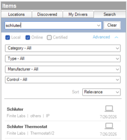

<!-- Copyright 2026 Finite Labs, LLC. All rights reserved. -->

______________________________________________________________________

# Overview

> DISCLAIMER: This software is neither affiliated with nor endorsed by either
> Control4 or Nuheat (Chemelex).

Integrate [Nuheat Signature and Conductor](https://www.nuheat.com) floor-heating
thermostats into Control4. This account driver links to your Nuheat account,
discovers every thermostat on it, and exposes each one as a connection you bind
to a companion **Nuheat Thermostat** driver, which appears in Control4 as a
native thermostat with setpoint, mode, and hold control.

The driver uses the official Nuheat OpenAPI. You sign in on Nuheat's own page,
so your Nuheat password is never entered in Control4.

# Index

- [System Requirements](#system-requirements)

- [Included Drivers](#included-drivers)

  - [Nuheat](#nuheat)
  - [Nuheat Thermostat](#nuheat-thermostat)

- [Compatibility](#compatibility)

- [Installer Setup](#installer-setup)

  - [Driver Installation](#driver-installation)
  - [Driver Setup](#driver-setup)
    - [Driver Properties](#driver-properties)
      - [Cloud Settings](#cloud-settings)
      - [Account Settings](#account-settings)
      - [Driver Settings](#driver-settings)
    - [Driver Actions](#driver-actions)
  - [Programming Reference](#programming-reference)

- [Support](#support)

- [Changelog](#changelog)

# System Requirements

- Control4 OS 3.3.0 or later
- A Nuheat account with at least one Signature or Conductor thermostat set up in
  the Nuheat app
- Internet access from the Control4 controller

# Included Drivers

## Nuheat

The account driver, and the driver to add first. Run its **Link Account**
action, open the link it shows, and sign in to Nuheat; it then discovers every
thermostat on the account and creates a connection for each one. The **Nuheat
Thermostat** drivers bind to those connections, so the account driver is the
only place the account is linked and the only cloud connection that is opened.

**Key features:**

- Sign-in on Nuheat's own page (OAuth), with the link kept short for typing
- Automatic discovery of every thermostat on the account
- One connection per thermostat, each bound to a companion thermostat driver
- State refreshed on a configurable poll interval, and read back after every
  change

## Nuheat Thermostat

The companion driver. Add one per physical thermostat and bind it to a
thermostat connection on the account driver. Each one appears in Control4 as a
native thermostat with setpoint, mode, and hold control.

**Key features:**

- Setpoint, Heat/Off mode, and hold control (until the next schedule event, or
  permanent)
- Temperature values communicated in Celsius, with the Control4 proxy handling
  display conversion to the project's configured scale

# Compatibility

This driver works with Nuheat Signature and Conductor thermostats on a Nuheat
account. The thermostat's own schedule keeps running; the Nuheat OpenAPI does
not offer schedule editing, so schedules are managed in the Nuheat app.

If you have a model that works and is not listed, please
[open an issue](https://github.com/finitelabs/control4-nuheat/issues/new) so it
can be added.

# Installer Setup

> ⚠️ Only a **_single_** Nuheat account driver instance is required per Nuheat
> account. Add one **Nuheat Thermostat** driver per physical thermostat.

## Driver Installation

Driver installation and setup are similar to most other ip-based drivers. Below
is an outline of the basic steps for your convenience.

1. Download the latest `control4-nuheat.zip` from
   [Github](https://github.com/finitelabs/control4-nuheat/releases/latest).

1. Extract and
   [install](https://www.control4.com/help/c4/software/cpro/dealer-composer-help/content/composerpro_userguide/adding_drivers_manually.htm)
   all `.c4z` files.

1. Use the "Search" tab to find the "Nuheat" driver and add it to your project.
    

1. Run the [Link Account](#link-account) action. The
   [`Authentication URL`](#authentication-url-read-only) property shows a link:
   open it in a browser within five minutes, sign in to Nuheat, and allow
   access.

1. After a few moments the [`Account Status`](#account-status-read-only) shows
   `Linked` and the [`Driver Status`](#driver-status-read-only) shows
   `Connected` with the number of thermostats found. If it does not, set the
   [`Log Mode`](#log-mode--off--print--log--print-and-log-) property to `Print`,
   run Link Account again, and check the Lua output window for details.

1. For each thermostat you want to control, use the "Search" tab to add a
   "Nuheat Thermostat" driver. In the "Connections" tab, select the "Nuheat"
   driver and bind each discovered thermostat to a "Nuheat Thermostat" driver.

Each companion driver includes its own documentation accessible from within
Composer Pro. Refer to the **Nuheat Thermostat** driver documentation for its
property, connection, and programming reference.

## Driver Setup

### Driver Properties

#### Cloud Settings

##### Automatic Updates \[ Off | **_On_** \]

Enables or disables automatic driver updates from GitHub releases.

##### Update Channel \[ **_Production_** | Prerelease \]

Sets the update channel considered during automatic updates from GitHub
releases.

#### Account Settings

##### Account Status (read-only)

Displays the link state: `Linked`, a prompt to open the Authentication URL, or
why the last sign-in failed (e.g. `The sign-in link expired`).

##### Authentication URL (read-only)

While Link Account is waiting, the link to open to sign in to Nuheat. Empty
otherwise.

#### Driver Settings

##### Driver Status (read-only)

Displays the current status of the driver (e.g. `Connected (2 thermostats)`).

##### Driver Version (read-only)

Displays the current version of the driver.

##### Poll Interval \[ 30 seconds | **_60 seconds_** | 120 seconds | 300 seconds \]

How often the driver reads the account's thermostats. A change made in Control4
is read back a few seconds after it is sent, whatever this is set to.

##### Log Level \[ 0 - Fatal | 1 - Error | 2 - Warning | **_3 - Info_** | 4 - Debug | 5 - Trace | 6 - Ultra \]

Sets the logging level. Default is `3 - Info`.

##### Log Mode \[ **_Off_** | Print | Log | Print and Log \]

Sets the logging mode. Default is `Off`.

### Driver Actions

#### Update Drivers

Trigger the driver to update from the latest release on GitHub, regardless of
the current version.

#### Link Account

Starts a sign-in: the [`Authentication URL`](#authentication-url-read-only)
property shows a link to open, valid for five minutes. Once you sign in and
allow access, the driver stays linked, across reboots, until you unlink it.
After the first link, a customer can also link again from the Control4 app, with
**Get Link** in any Nuheat thermostat's extras.

#### Unlink Account

Signs out of Nuheat and forgets the account's tokens. Connection bindings are
kept, so linking the same account again restores control without re-binding.

#### Refresh Thermostats

Re-reads the account and refreshes the discovered thermostats and their
connection bindings.

#### Reset Driver

> ⚠️ This will reset all connection bindings and delete any programming
> associated with them.

Signs out and removes all dynamically created thermostat connections. Run Link
Account afterwards to rediscover from scratch. Useful if thermostats were added,
removed, or renamed on the account.

**Parameters:**

- **Are You Sure?** \[ **_No_** | Yes \] - Confirmation to reset the driver.

## Programming Reference

Once signed in, the driver creates one **provider** connection per thermostat on
the account (binding class `NUHEAT_THERMOSTAT`), named after the thermostat's
name. Bind each to a **Nuheat Thermostat** companion driver; that companion
exposes the standard Control4 thermostat proxy for programming (setpoint, mode,
hold, temperature). This account driver has no directly programmable variables
of its own. All thermostat control and feedback is on the companion.

# Support

If you have any questions or issues integrating this driver with Control4, you
can file an issue on GitHub:

https://github.com/finitelabs/control4-nuheat/issues/new

# Changelog

<!--
Template for a new release entry (copy below the heading, fill in, uncomment):

## v[Version] - YYYY-MM-DD

### Added
- Added

### Fixed
- Fixed

### Changed
- Changed

### Removed
- Removed
-->

## Unreleased

### Added

- Initial release.
- A **Nuheat** account driver that links to a Nuheat account through the Nuheat
  OpenAPI (sign-in on Nuheat's own page, no password in Control4), discovers its
  Signature and Conductor thermostats, and polls them on a configurable
  interval.
- A **Nuheat Thermostat** companion driver that presents each thermostat as a
  native Control4 thermostat: floor temperature, heat setpoint, Heat/Off, and
  Until Next / Permanent holds.
